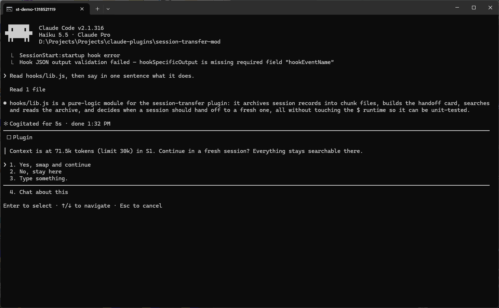
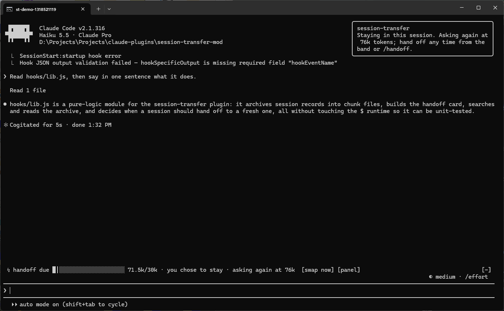
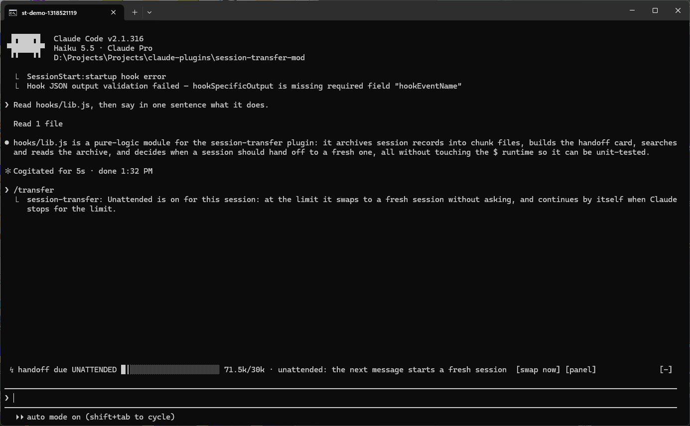
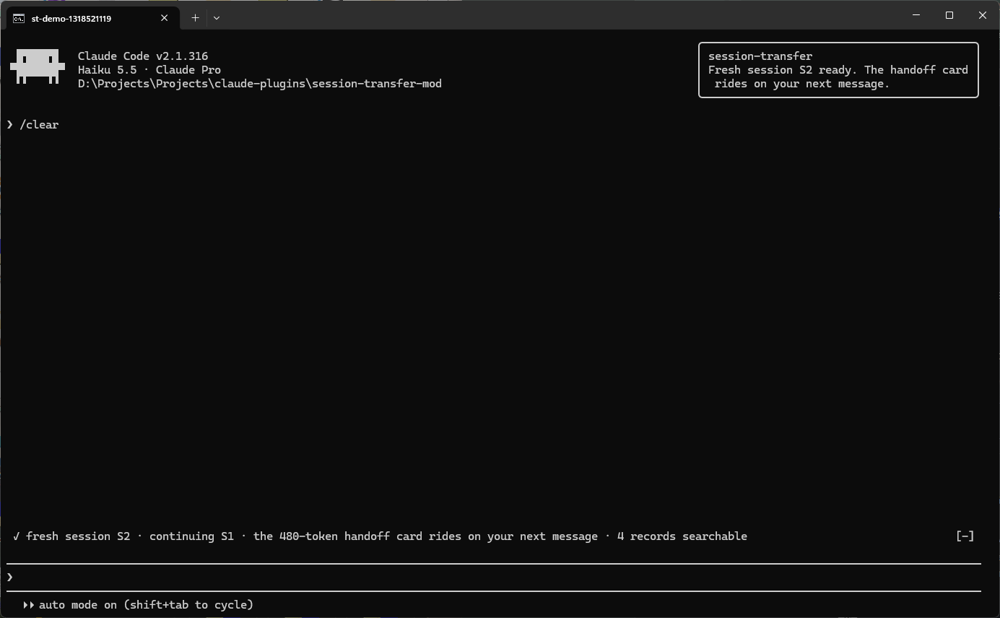
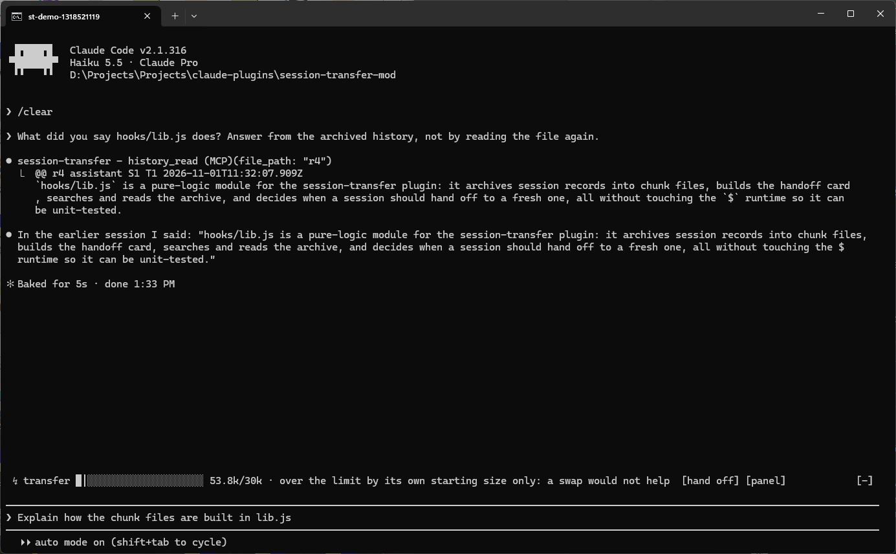
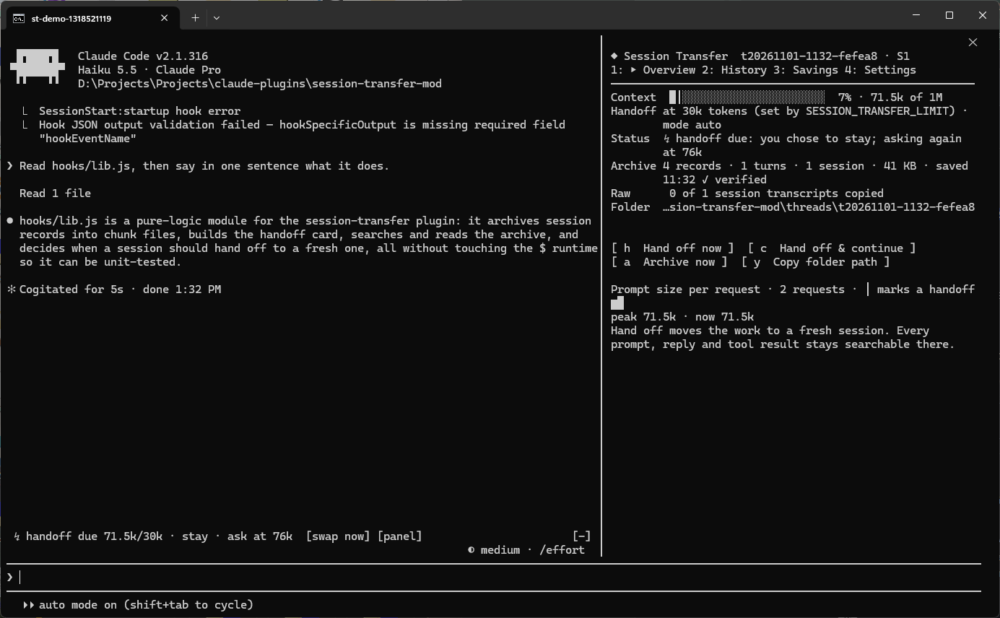
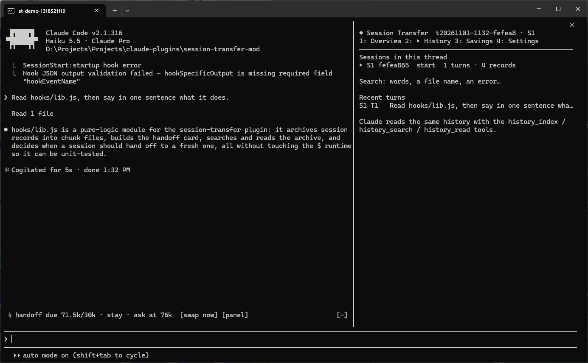
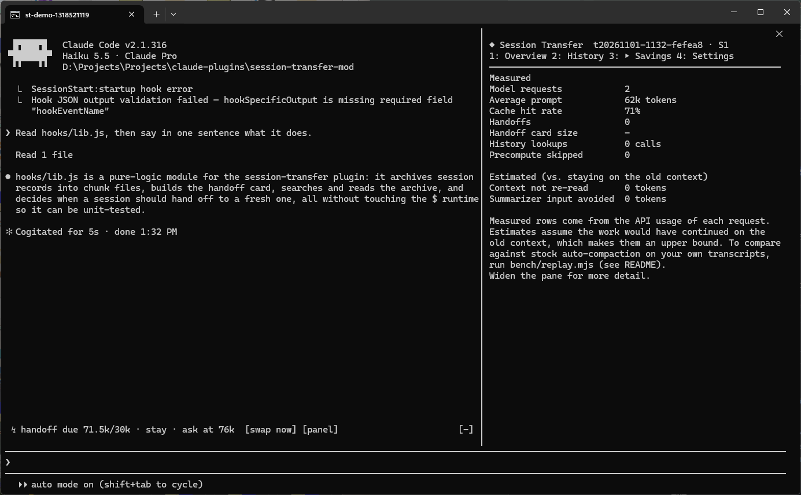
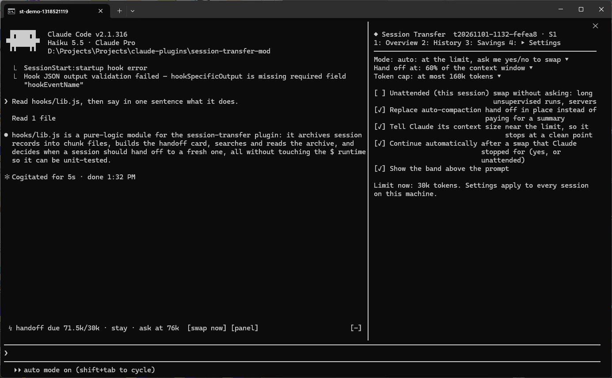

# session-transfer

A Claude Code mod that keeps long sessions cheap. When a session's context
gets big, the mod offers to move the work to a **fresh session** instead of
compacting it. The whole old session stays on disk as a **searchable
archive**. The fresh session starts with a small handoff card, about 0.5k
tokens, that points at the archive. It is not a summary. Claude looks up what
it needs, when it needs it.

**Nothing swaps without your yes.** At the limit, Claude Code's own question
dialog asks *Continue in a fresh session?* Only a session you mark
**unattended**, for long unsupervised runs or a server, swaps without asking.

```
 S1 ─────────────────────────▶ limit ─ "Continue in a fresh session?" ─ yes ┐  archive: every prompt, reply,
                                                                            │  tool call and tool result
 S2  card ──────────────────▶ limit ─ ...                                   │  + raw JSONL copy
                                                                            │
     history_index / history_search / history_read ◀────────────────────────┘
```

Tested live on Claude Code 2.1.316, Windows 11, Windows Terminal. The Desktop
surface's drawing is checked in the test kit only.

## Screenshots

These come from a real session, captured by `scripts/capture-screenshots.ps1`
with `SESSION_TRANSFER_LIMIT=30000` so that the first reply reaches the
limit. The two "SessionStart hook error" lines at the top come from an
unrelated settings hook on the capture machine.

**1. At the limit you're asked; nothing happens without a yes.** The dialog
is Claude Code's own AskUserQuestion. Claude stopped at a clean point, so
the yes option says *swap and continue*.



**2. "No, stay here" keeps the session.** You're asked again only after the
context grows another 15% of the limit. The band says so, and *[swap now]*
is always there.



**3. Unattended, per session** (`/transfer unattended on`, or the Settings
tab). The band shows `UNATTENDED`. At the limit the next message goes to a
fresh session without a question.



**4. After the swap.** A fresh session S2; the 480-token handoff card rides
on your next message.



**5. The fresh session looks things up instead of guessing.** Asked about
earlier work, Claude reads record `r4` of S1 from the archive. The band
explains that S2 is over the 30k demo limit only by its own starting size,
so a swap wouldn't help and none is offered.



**6. The panel** (`/transfer`): Overview, History, Savings, Settings.

| Overview | History |
|---|---|
|  |  |
| **Savings** | **Settings** |
|  |  |

## Why

Every request re-sends the whole context. A session at 400k tokens re-sends
400k tokens on every tool call. Prompt caching cuts the price of the
re-reading, but it does not remove it. Anthropic's guidance points the same
way:

- Context rot sets in as context grows, and "compaction isn't sufficient" for long-horizon work.
- Use **just-in-time retrieval through lightweight identifiers** and **structured notes**.

([effective context engineering](https://www.anthropic.com/engineering/effective-context-engineering-for-ai-agents),
[long-running agents](https://www.anthropic.com/engineering/effective-harnesses-for-long-running-agents))

Compaction also has a cost of its own. `/compact` reads the whole context to
summarize it ([costs](https://code.claude.com/docs/en/costs)). On the machine
this mod was built on, 16 compactions took **971 s** of waiting in total.

The technique follows [mainplane](https://github.com/mainplane-ai/mainplane),
but uses none of its code. mainplane turns compaction off, gives each session
a hard context limit the agent can see, and writes every record to an
append-only log. Its `/continue` starts a blank session with one line
pointing at the old log ("Retrieve key context from it as you go"). This mod
does the same inside Claude Code:

| mainplane | session-transfer |
|---|---|
| append-only `.state` log, header line + raw body | immutable chunk files, `@@ r<n> <kind> S<k> T<turn> <time> len=<chars>` + exact body, read back after writing |
| "time 3m12s context 48210" after every tool result | a short, attributed context note after tool results near the limit only |
| hard `context_limit` | a limit you choose (default: 60% of the window, at most 160k), then a yes/no |
| `/continue`: blank session + pointer to the log | `/clear` + a **card** on the first message: archive location, how to search, where work stopped, task list, files touched, notes |
| `rg` over the `.log` | `history_index`, `history_search`, `history_read`, or `rg` over the folder |
| AGENTS.md for durable knowledge | `history_note`: notes that ride in every later card |

## Who decides when to swap

| | at the limit | your messages |
|---|---|---|
| **auto** (default) | When the turn ends, a yes/no dialog. **Yes** swaps (and continues, if Claude stopped mid-task). **No**, a dismissal, or nobody there to answer (`-p`) keeps the session; you're asked again after another 15% of the limit. | never moved |
| **manual** | The band says a handoff is due. You swap with `[swap now]`, `/handoff`, or the panel. | never moved |
| **off** | Archive only. | never moved |
| **unattended** (per session; has priority over the mode) | No question. When Claude stops for the limit, it swaps and continues. Otherwise the next prompt from any source (you, the SDK, a scheduled task) moves to the fresh session with the card. | moved, text unchanged; a message with attachments stays |

Turn unattended on:

- **Per session:** `/transfer unattended on|off`, or *Unattended (this
  session)* in Settings. It's stored on the work thread, so it survives that
  thread's own swaps. A new session, or a `/clear` you type yourself, starts
  supervised again.
- **For a whole process**, like a server or CI: `SESSION_TRANSFER_UNATTENDED=1`.
  This forces it on, and `/transfer unattended off` can't override it.
- **Server limit:** `SESSION_TRANSFER_LIMIT=<tokens>` sets the limit directly,
  ignoring the percentage settings.

Two guards apply in every mode:

- **Growth floor.** A session is never swapped when it's over the limit only
  because of its own starting size (system prompt, tools, card). It must grow
  at least 4k tokens or 10% of the limit past its first prompt. Without this,
  an unattended session whose base is above the limit would swap forever.
- **Explicit actions are the approval.** Typing `/handoff`, or pressing
  `[swap now]` or *Hand off now*, swaps at once.

**Replace auto-compaction** (on by default) is separate. If the engine
compacts in the middle of a turn anyway, the mod answers with the card plus
the current turn's messages, so no summary is paid for. This isn't a session
swap, and the engine would have compacted without asking too. A `/compact`
you type yourself runs as normal, and its summary is told the archive
exists.

## Proof

**Tests that fail when the rules break.** `claude plugin test` runs 42 tests.
The approval tests drive Claude Code's real question path (an AskUserQuestion
stub that records every question and its options). They prove:

- what you were asked, and with which options
- nothing swaps on a no, a dismissal, or with nobody to ask
- a no is remembered until the context grows
- manual mode never asks
- unattended never asks, survives its own swaps, and never loops on a fresh session's base size
- the context note never orders a supervised session to stop

`node scripts/mutation-check.mjs` checks that the tests themselves work. It
plants 11 bugs in those rules, one at a time, and requires the suite to fail
for each: **11/11 caught**.

**Recall, live.** `node scripts/e2e-live.mjs` drives a real headless Claude
Code session on Haiku:

1. The agent reads a file that holds a random id, so the id enters the conversation only as a tool result.
2. The script runs `/handoff`.
3. It asks the fresh session for the id.

```
PASS reply archived to a verified chunk  — 4 records, 1 chunk(s)
PASS the tool result holding the secret is in the archive
PASS /handoff started a fresh session id
PASS the raw JSONL transcript was copied
PASS fresh session runs on a new id
PASS the history tools were used after the handoff  — Read, ToolSearch, mcp__session-transfer__history_search
PASS the fact from before the handoff was recovered  — "ZEBRA-3393-QUOKKA"
PASS the fresh session received the handoff card  — 1742 chars
PASS the card does not contain the secret (so the answer came from a lookup)
PASS the secret was not re-read from the file after the handoff
10/10 checks passed.
```

**Cost, replayed on real transcripts.** `node bench/replay.mjs` reads your
own `~/.claude/projects/*.jsonl` and replays each session's prompt growth two
ways: as it really happened (stock, compactions included), and with
handoffs. Both use one cache price model. Results on this machine, 33
sessions with 60 or more requests (5,118 requests):

| hand off at | swap at your next message (`--handoff prompt`, conservative) | swap when Claude stops at the limit (`--handoff stop`: you said yes, or unattended) |
|---|---|---|
| 80k | input cost −41% · prompt tokens −46% | input cost −65% · prompt tokens −75% |
| **120k (default on a 200k window)** | **input cost −38% · prompt tokens −43%** | **input cost −60% · prompt tokens −68%** |
| 160k | input cost −34% · prompt tokens −39% | input cost −54% · prompt tokens −61% |
| 200k | input cost −32% · prompt tokens −36% | input cost −48% · prompt tokens −55% |

How the replay works, and its limits:

- Each request's prompt size comes from the API usage that request recorded.
- Cached reads cost 0.1x and cache writes 1.25x.
- Each stock compaction pays its summarizer, which reads the whole context and writes 8k tokens.
- A `/compact` you typed yourself runs, and is charged, on both sides.
- The request that crosses the limit is billed in full.
- Every handoff pays 1.5k for the card plus a 3k lookup allowance.
- The fresh-session base is the median first prompt of 125 fresh sessions (47k).
- The model prices stock *below* what was actually billed (159.3M against 172.4M), so the comparison errs in stock's favor.
- It does **not** measure answer quality or extra turns. The e2e check covers recall; a quality claim needs paired runs of the same task.

## Install

Load it for one session:

```powershell
# Windows PowerShell
claude --plugin-dir D:\path\to\session-transfer-mod
```

```bash
# macOS / Linux
claude --plugin-dir ~/path/to/session-transfer-mod
```

To load it in every session, including the Desktop app's Code tab, add the
folder to `CLAUDE_CODE_PLUGIN_DIRS` in `~/.claude/settings.json`. Use an
absolute path, with `;` between entries on Windows and `:` on macOS:

```json
{ "env": { "CLAUDE_CODE_PLUGIN_DIRS": "D:/path/to/session-transfer-mod" } }
```

Requires Claude Code 2.1.287 or later (mods). `/plugin` should list
`session-transfer` among the active mods.

## Using it

- **The band** above the prompt shows:
  - a context gauge with the limit marked (`│`), the session (`S2`), and the archive size
  - the state: due, suggested, *you chose to stay*, or `UNATTENDED`
  - the buttons `[hand off]`/`[swap now]` and `[panel]`
- **`/handoff`** hands off now; the card rides on your next message.
  **`/handoff continue`** also continues the work.
  **`/handoff <message>`** sends the message to the fresh session.
- **`/transfer`** opens the panel. **`/transfer unattended on|off`** sets
  unattended for this session.
- **Ask Claude** "check what we did so far". The card tells it to call
  `history_index` first, then search and read what matters.
- **A new session in the same project** offers to continue the last thread
  (*continue it* / *start fresh*).

## Where things live

```
~/.claude/session-transfer/<project-slug>/
  README.md                         the record format, for people and agents
  latest.json                       the project's newest thread
  threads/<thread>/
    thread.json                     sessions S1..Sn (a tree: /branch and /resume fork it), handoffs, notes, stats, unattended
    thread.prev.json                the previous good manifest
    S1-<session8>/c000001-r1-r42.md immutable chunks
    raw/<session>.jsonl             Claude Code's own transcript, copied at each handoff
```

The archive lives outside the project, so it never ends up in git and never
gets hidden by `.gitignore`. Claude Code deletes its own transcripts after
`cleanupPeriodDays` (30 by default). The copies in `raw/` stay. Delete a
thread folder whenever you like.

## How it works

| event | what the mod does |
|---|---|
| `turn.complete` | Archives the messages not yet archived as a new chunk: written, read back, then the manifest is committed. Then it decides: suggest (yes/no), wait, or, if unattended, swap. |
| `turn.step` | Records each request's prompt size and cache use. The first one is the session's floor. |
| `tool.call` | Near the limit, adds an attributed note after the result. For a supervised session it only informs. |
| `prompt.submit` | In an unattended session at the limit, holds the message, hands off, and forwards it. |
| handoff | archive → verify → copy raw JSONL → `/clear` → wait for the new session id → card. Each phase is saved under `op` in the mod store. On failure your message goes back into the prompt. |
| `prompt.context` | Adds the card as a context block on the fresh conversation's first message, once. |
| `session.compact` | Skips `precompute`. Answers `auto` with the card instead of a summary. `manual` runs as normal. |

What `claude plugin validate` lists:

- `$.fs.read/write/exists/list` (the archive)
- `$.process.run` (`git rev-parse` for the branch; `Copy-Item` on Windows or `cp` elsewhere for the raw copy)
- `$.command.run` (`/clear`), `$.ui.ask` (the yes/no), `$.prompt.submit/fill`, `$.session.*`
- `$.store` (settings, the session→thread map, the pending card)
- `$.tool.register` (four tools, deferred behind ToolSearch so they cost nothing until used)
- `$.env.get` (`OS`, `HOME`, `USERPROFILE`, `CLAUDE_CONFIG_DIR`, `SESSION_TRANSFER_UNATTENDED`, `SESSION_TRANSFER_LIMIT`)

## Develop

```bash
claude plugin validate .
claude plugin test                         # 42 tests
node scripts/mutation-check.mjs            # plants 11 bugs in the approval rules; each must fail the suite
node scripts/e2e-live.mjs                  # live recall check on Haiku (a few cents)
node bench/replay.mjs                      # replay your transcripts; --handoff prompt|stop --limit 160000 --json
pwsh -File scripts/capture-screenshots.ps1 # re-take docs/screenshots (opens a terminal; hands off the keyboard)
```

The screenshot script types into its own terminal window. It checks that the
window is in front before every key and stops if it isn't. It disables your
other plugins for that one session through a `--settings` file (your
settings stay untouched), and deletes the demo's archive threads afterwards.

## Limits

- A handoff runs `/clear`, which empties the screen's transcript. Everything
  is still in the archive, and `/resume` reopens the old session.
- The mod's own `$.prompt.submit` doesn't pass through its own
  `prompt.submit` hook. That is why the card goes on the first-message
  context block.
- A note after a tool result that gives orders reads like a prompt
  injection. In a live run Claude ignored the first version of the note for
  that reason. The note now names its source and only informs, except in an
  unattended session, which asks for a clean stop.
- `$.session.messages()` returns at most the newest 4,096 entries. The mod
  archives after every reply, so it stays inside that window. If continuity
  can't be proven, the session is marked `coverage: unproven` and the raw
  JSONL copy is the fallback.
- A body over 1M characters is written as numbered parts of the same
  record. Nothing is cut.
- An archive write is a transaction. Chunks are written and read back first;
  then the manifest is committed and verified, with the previous one kept.
  The cursor moves only after that. A chunk that landed before a failed
  manifest write is adopted again on the next load.
- A handoff interrupted by a reload or a crash puts your held message back
  in the prompt. It is never replayed blindly.
- Subagent transcripts live in `raw/<session>/subagents/`. The chunks keep
  each subagent's final report, as the main conversation saw it.
